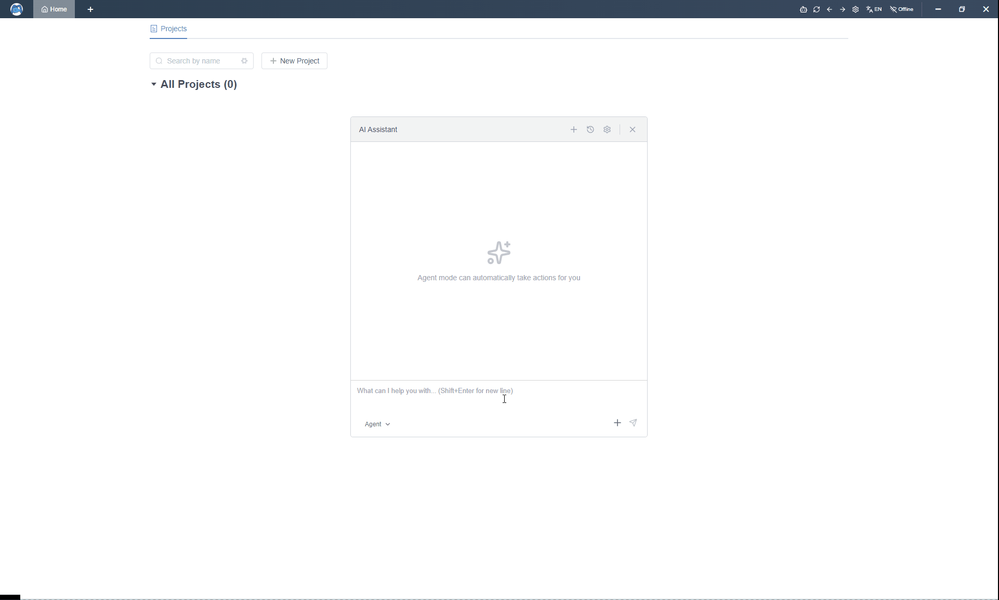
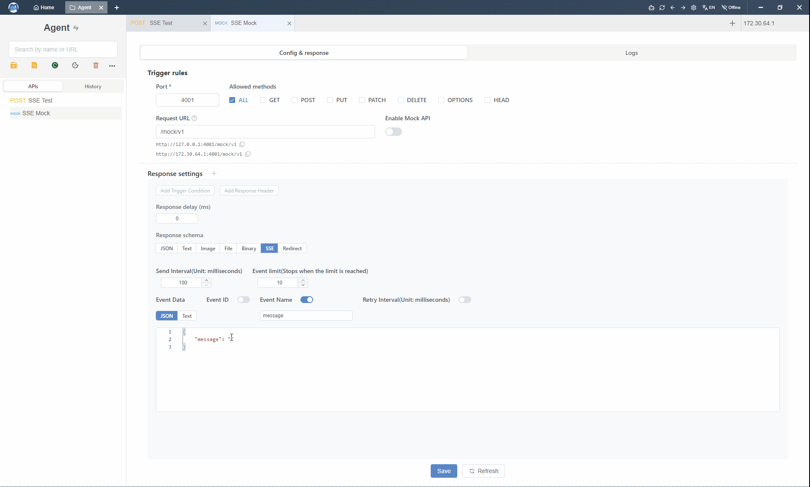

<div align="center">


# Apiflow

## A Free, AI-Powered API Tool like Postman

[中文](./README_CN.md) | English

[](https://github.com/trueleaf/apiflow/releases/latest)
[](https://github.com/trueleaf/apiflow/blob/master/LICENSE)
[](https://github.com/trueleaf/apiflow/releases/latest)

[Download](https://github.com/trueleaf/apiflow/releases)  | [Online Demo](https://apiflow.cn/)


<!-- [Download](https://github.com/trueleaf/apiflow/releases) ·
[Online Demo](https://apiflow.cn) -->
<!-- [Documentation](https://www.yuque.com/apiflow) · -->

</div>

---
# Preview

## AI Agent


## Server-Sent Events (SSE)


---
# What is Apiflow?

**Apiflow** is a **completely free**, **AI-powered API development platform** designed as a modern alternative to **Postman**, **Hoppscotch**, and **Insomnia**.

It supports **API testing**, **mocking**, **WebSocket**, **AI agents**, **team collaboration**, **offline usage**, and **local deployment** — while fully embracing the **OpenAPI 3.0 ecosystem**.

---

# Key Features

## 100% Free
- All features are free to use
- No paid plans, no feature limits

## AI Agent Built-In
- Built-in AI Agent for API design, testing and debugging
- Configure your own Large Language Model
- Works in offline or intranet environments

## Team Collaboration

- Built-in team and workspace management
- **Unlimited teams and members**
- Fine-grained permission control:
  - Project-level permissions
  - Role-based access control (RBAC)
  - Read / write / admin roles
- Operation history and change tracking
- Designed for teams of any size

## Offline & Online

- Local-first by design, online when you need it
- Full offline capability with local persistence
- Bidirectional conversion between offline and online data
- Smooth transition from personal usage to team collaboration
- Ideal for private networks and restricted environments


## Self-Hosted & Local Deployment
- One-click Docker deployment
- Data fully controlled by yourself
- Suitable for enterprises and private networks

## OpenAPI Friendly
- Import & export **OpenAPI 3.x**
- Save completed JSON, text, and empty HTTP responses as named examples, including their status codes and content types
- Include multiple examples for the same status code in offline OpenAPI exports
- Preserve folder grouping and URL prefixes when importing OpenAPI documents
- Seamlessly migrate data to:
  - Postman
  - Insomnia
  - Hoppscotch
  - Any OpenAPI-compatible tool

---

# Core Capabilities

- HTTP API testing (RESTful)
- WebSocket testing
- Mock Server (HTTP / WebSocket / SSE)
- Environment & variable system
- Pre-request & post-request scripts
- Project & folder management
- Import / Export (Postman, OpenAPI, JSON)
- Internationalization (EN / ZH / JA)

---


# Download

Download the latest version for your platform:

| Platform | Download |
|---------|----------|
| Windows | https://github.com/trueleaf/apiflow/releases |
| macOS | https://github.com/trueleaf/apiflow/releases |
| Linux | https://github.com/trueleaf/apiflow/releases |

Desktop releases from v0.9.82 use Tauri and Rust. When upgrading from an Electron-based release, back up your local data using **Settings → Local Data → Data Backup / Export**, then install the new package and restore the backup in the new client. Download the installer directly for this transition; the new client uses a signed Tauri update feed.

---

# Local Deployment

## Server Deployment

### Docker Deployment

#### Requirements
- Docker
- Docker Compose

#### First Deployment

```bash
git clone https://github.com/trueleaf/apiflow
cd apiflow

cp .env.example .env
# edit .env to configure MongoDB credentials

docker compose pull
docker compose up -d

# Verify deployment
curl http://localhost
curl http://localhost/api/health
```

#### Adding Users After Deployment

After successfully deploying Apiflow, follow these steps to add users:

1. **Switch to Internet Mode**
   - Click the network mode toggle in the application (usually in the top-right corner)
   - Select "Internet Mode" to enable online features

2. **Login with Default Admin Account**
   - Username: `admin`
   - Default Password: `111111`
   - **Important**: Change the default password after first login for security

3. **Add New Users**
   - Navigate to the admin panel/backend management
   - Find the user management section
   - Click "Add User" to create new accounts for your team members

#### Code Update

If you are running Apiflow with Docker, updating the code does not require rebuilding locally.

**Option 1: Using Update Script (Recommended)**

```bash
# Make scripts executable (first time only)
chmod +x update.sh rollback.sh

# Run update
./update.sh
```

**Option 2: Manual Update**

```bash
docker compose down
docker compose pull
docker compose up -d
```

**Rollback (recommended: snapshot-based rollback)**

```bash
# Option 1: rollback to the latest snapshot created by update.sh (recommended)
./rollback.sh --previous

# Option 2: rollback to a specified snapshot file (recommended)
./rollback.sh --file current_versions_20260122_120000.txt

# Option 3: compatibility mode, rollback by tag/sha (not guaranteed to be exact, for emergencies)
./rollback.sh v1.2.3
# ./rollback.sh 7f3a2b1c4d5e
```

## Client Build

After deploying with Docker you can access the system directly via browser. If you want to use the full desktop experience, follow the steps below to build the client.

### Prerequisites
- **Node.js**: >= 22.12.0
- **Rust**: >= 1.85 with the native toolchain for your target platform
- **macOS**: Xcode Command Line Tools required (`xcode-select --install`)
- **Linux**: WebKitGTK 4.1, AppIndicator, OpenSSL development packages, `patchelf`, `fakeroot` and `dpkg`
- Each platform's installer can only be built on its native OS (no cross-platform compilation)

#### Step 1: Speed up downloads (optional)

If npm downloads are slow, uncomment the registry line in the root `.npmrc`:

```properties
registry=https://registry.npmmirror.com
```

#### Step 2: Clone the repository and install dependencies

```bash
git clone https://github.com/trueleaf/apiflow.git
cd apiflow
npm install
```

#### Step 3: Modify configuration (as needed)

Edit `packages/web/src/config/config.ts` and adjust the following settings as required:

```typescript
// Change the backend server URL
// Default points to the official server; replace with your own when self-hosting
httpRequest: {
  url: isDev ? 'http://127.0.0.1:7001' : 'https://your-server.example.com',
  // ...
},
```

> **Note:** After packaging, the server URL can also be updated at any time in the app via **Settings → App Config → API Endpoint**, without needing to repackage.

#### Step 4: Run the build command for your platform

```bash
# Windows
npm run web:build:local:win

# macOS
npm run web:build:local:mac

# Linux
npm run web:build:local:linux

# Quick verification only (build the native binary without an installer)
npm run web:build:local:pack

# Microsoft Store MSIX (requires Windows SDK)
npm run web:build:local:win:store
```

> **Tip (Windows):** Install the Windows SDK to build MSIX packages. The Store package includes the official WebView2 fixed runtime.

### Build Commands

| Command | Description |
|---------|-------------|
| `npm run web:build:local:pack` | Build the Tauri binary without an installer |
| `npm run web:build:local:win` | Build Windows NSIS `.exe` and MSI `.msi` installers |
| `npm run web:build:local:win:store` | Build a Microsoft Store `.msix` package |
| `npm run web:build:local:mac` | Build macOS bundles on macOS |
| `npm run web:build:local:linux` | Build Linux packages on Linux |

### Output Directory

Tauri installers are located in `packages/web/src-tauri/target/release/bundle/`. Microsoft Store packages are written to `packages/web/release/`.

For tagged releases, configure the repository secret `TAURI_SIGNING_PRIVATE_KEY` and variable `TAURI_UPDATER_PUBLIC_KEY` before running `.github/workflows/build-tauri.yml`. Set `TAURI_SIGNING_PRIVATE_KEY_PASSWORD` if the key is encrypted. The tag must match `v` plus `packages/web/package.json`'s version. The workflow creates signed updater metadata and draft release assets; submit the generated MSIX to Partner Center separately.

---

# Local Development

## Prerequisites
- **Node.js**: >= 22.12.0
- **MongoDB**: Running locally or accessible remotely
- **Git**: For cloning the repository

## Getting Started

1. **Clone the repository**

```bash
git clone https://github.com/trueleaf/apiflow.git
cd apiflow
npm install
```

2. **Start development servers**

```bash
npm run dev
```

This command will start both the frontend and backend servers concurrently:
- **Frontend (Tauri)**: http://localhost:4000 inside the desktop application
- **Backend (Server)**: http://localhost:7001

## Available Commands

| Command | Description |
|---------|-------------|
| `npm run dev` | Start both frontend and backend in development mode |
| `npm run dev:web` | Start the browser-only frontend |
| `npm run web:dev` | Start the Tauri desktop frontend |
| `npm run server:dev` | Start only the backend |
| `npm run web:build` | Build the web application |
| `npm run server:build` | Build the server application |
| `npm run server:test` | Run server unit tests |
| `npm run bootstrap` | Install all dependencies |

## Project Structure

This is a multi-package monorepo:

- `packages/web` - Web and Tauri desktop application (Vite + Vue 3 + Rust)
- `packages/server` - Backend application (Midway.js + MongoDB)
- `packages/website` - Marketing website (Next.js)

## Development Tips

- Ensure MongoDB is running before starting the server
- The frontend supports hot module replacement (HMR) for fast development
- Backend auto-restarts when files change
- You can develop packages independently by running their specific dev commands

---

# License

This project is licensed under the **MIT License**.  
See the [LICENSE](./LICENSE) file for details.
